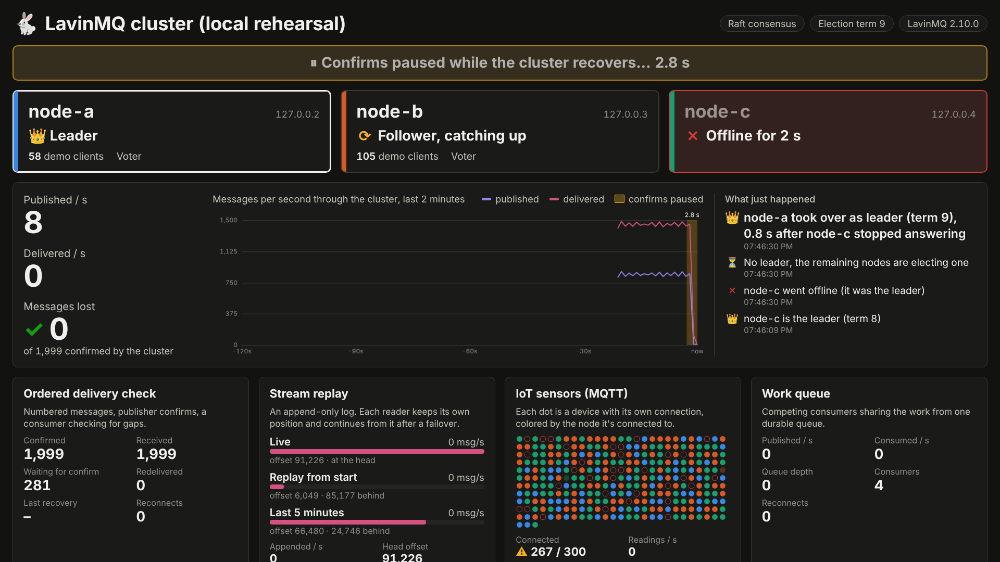

# LavinMQ booth demo

A conference booth demo of a three-node LavinMQ cluster on Raspberry Pis. A
laptop on the same switch runs four load scenarios against the cluster and
shows a big-screen dashboard. Pull the power on any Pi: visitors see the
cluster elect a new leader, the clients reconnect, and the messages-lost
counter stays at 0.

```
 ┌────────┐ ┌────────┐ ┌────────┐
 │  pi-1  │ │  pi-2  │ │  pi-3  │   LavinMQ cluster (Raft), see pi/README.md
 └───┬────┘ └───┬────┘ └───┬────┘
     └──────────┼──────────┘
             switch
                │
          ┌─────┴─────┐
          │  laptop   │  bin/booth: load generators + dashboard on :8080
          └───────────┘
```

## What visitors see



- **Node tiles.** Each Pi shows as Leader 👑, Follower in sync, Catching up,
  or a big red Offline with a timer. The colored stripe on each tile matches
  that node's dots in the IoT grid.
- **Throughput.** Published and delivered msg/s over the last 2 minutes.
  Every outage appears as a shaded band labelled with how long the publishers
  went without confirms.
- **Pulling a follower pauses confirms too,** for a few seconds. The leader
  only confirms what every in-sync node has. It waits until it drops the dead
  follower from the in-sync set, then carries on. This is a good talking
  point: a confirm means "safe on every node in sync", not just "the leader
  has it".
- **Messages lost: 0.** This comes from the ordered delivery check.
- **What just happened.** "pi-1 went offline (it was the leader)", "pi-3 took
  over as leader (term 7), 1.6 s after pi-1 stopped answering", "Confirms
  flowing again after 3.1 s, 0 messages lost", "pi-1 has caught up and is in
  sync".

## The scenarios

| Scenario | What it shows |
|---|---|
| **Ordered delivery check** | A publisher numbers each message and waits for publisher confirms. A consumer checks for gaps. Anything unconfirmed when a connection drops is published again, so redeliveries are expected (at-least-once). A message the broker *confirmed* that never arrives counts as **lost**, after a 30 s grace period. |
| **Stream replay** | A producer appends to a stream queue. Three readers keep their own offsets: *Live* (from `next`), *Replay from start* (from `first`, rate limited so it visibly catches up, and it starts over a minute after catching up), and *Last 5 minutes* (from a timestamp). After a failover each reader continues from its own offset ("resumed 1×"). |
| **IoT sensors (MQTT)** | 300 devices by default, up to 2000. Each device has its own MQTT connection and sends a reading every ~2 s. Connections spread evenly over all three Pis. Each dot is one device, colored by the Pi it's connected to. Pull a follower and a third of the dots go dark, then come back. Pull the leader and all of them blink. |
| **Work queue** | Two confirming publishers and four competing consumers on a durable queue. |

All queues have length limits, so the Pis' disks don't fill up over a
three-day show.

## Running it

You need [Crystal](https://crystal-lang.org/install/) ≥ 1.21 on the laptop.

```sh
shards install
shards build --release
cp booth.example.yml booth.yml   # set the Pis' IPs and the booth user's password
bin/booth -c booth.yml
```

Open <http://localhost:8080/> full screen on the booth display.

- **Operator panel:** press <kbd>o</kbd> (or open `/?operator`). It has
  start/stop and a rate slider per scenario, **Hand over leadership** (a
  graceful handover, about 0.5 s), and **Reset demo**.
- **Raise the open-files limit** before starting with many IoT devices:
  `ulimit -n 10000`.
- `bin/booth --debug` logs every reconnect.

## How a dead Pi is noticed

A Pi that loses power sends nothing: no FIN and no RST. So every client
relies on timeouts.

- **AMQP connections** negotiate a 2 s heartbeat and use a 3 s read timeout.
  New connections try the current leader first. A follower would forward
  them to the leader, but going direct saves a hop.
- **MQTT devices** wait for a PINGRESP after every reading.
- **The dashboard** polls each Pi's metrics port (15692) for its own Raft
  state every 500 ms with a 400 ms timeout. It polls `/api/cluster` through
  the leader for the ISR and members.

So after a leader loses power, the timeline is roughly:
- **~1.5 s:** election timeout, then a new leader.
- **≤ 3 s:** clients notice the old connection is dead.
- **Then:** clients reconnect.

## Rehearsing without Pis

`dev/local-cluster.sh` runs three nodes on 127.0.0.2–4 on one Linux machine.
`kill -STOP` simulates a pulled plug, because a stopped process doesn't close
its sockets either.

```sh
dev/local-cluster.sh start path/to/lavinmq   # built from the raft-election branch
bin/booth -c booth.local.yml
kill -STOP "$(cat /tmp/booth-cluster/node2.pid)"   # pull the plug on 127.0.0.2
kill -CONT "$(cat /tmp/booth-cluster/node2.pid)"   # plug it back in
dev/local-cluster.sh stop
```

## Etcd clusters

The dashboard also works against a cluster using the etcd backend (any
released LavinMQ). It reads the leader from the metrics and the followers
from `/api/nodes`. Failover then takes about 10 s (the etcd lease TTL)
instead of 2–3 s, and "Hand over leadership" isn't available.

## Development

```sh
crystal spec
crystal tool format --check src spec
bin/ameba   # after `shards install`
```

The dashboard (`public/`) is plain HTML, CSS and JS with no build step and no
CDN, because booth networks are unreliable. It's compiled into the binary, so
rebuild after changing it.
